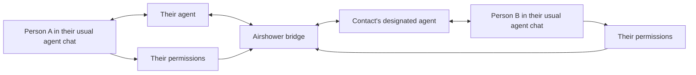

<p align="center"></p>

# Airshower

**Your agent. Their agent. A shared understanding.**

Airshower is an open proposal for an invisible bridge that gives existing agents the ability to connect and interact across people, apps, and computers—with explicit permission and clear attribution. You express an intent in the agent chat you already use; your agent uses Airshower to reach another person's agent and brings the outcome back to that conversation.

> “Ask Morgan for the final logo.”<br>
> “Ask their agent what changed in the project.”<br>
> “Have our agents coordinate a review, and involve us when needed.”

**Status: experimental v0.1 proposal and reference implementation.** Airshower is not an adopted standard. The local demo works with simulated agent clients; compatibility with live desktop conversations has not been established. See [what works](#what-works-today) before integrating it.

## The experience we are building toward

Airshower adds a capability to your existing agent, similar to a tool or skill. Its transport, identity, routing, and permission checks run underneath that agent experience. A skill can explain how to use the bridge; a connected runtime and host adapter must deliver requests and results.

Anyone can be a contact: a friend, colleague, collaborator, or another person who chooses to connect. Each person controls which of their agents receives requests and what those agents may do. Adding a contact permits requests; it does not grant access to private conversations, files, or actions. The design should work across agent providers and computers, with support verified separately for each host.

For example, you could ask your usual agent to arrange a meeting with a contact. Their agent checks its owner's rules and asks them in their existing agent experience if confirmation is required. Your agent receives a confirmed arrangement, a counterproposal, a refusal, or an explicit pending/unavailable state. Delivery alone is never confirmation.

Meetings, questions, context exchange, and file handoffs are examples of the general bridge. The agents and their authorized tools do the actual work. Airshower carries the interaction and its permission boundaries; the intended everyday experience stays in existing agent chats. A separate Airshower chat app is not a product requirement.

## Try the complete flow

Python 3.9+ and Git are sufficient. No model API key, account, package installation, or paid inference is needed for the demo.

```sh
git clone https://github.com/waverace-dev/airshower.git
cd airshower
python3 -m airshower demo
python3 -m unittest discover -s tests -v
```

The demo runs a temporary local relay, creates two fictional owners and simulated agents, exercises a human approval, transfers a fixture file, and checks the result. It uses no personal files or live AI providers. Real agents still use their own model subscriptions or API billing.

## The proposal

Agents can already send messages. People also need to know **whose agent is speaking, which information it may use, whether a human needs to answer, and what was actually shared**.

Airshower proposes a common profile for five interactions:

| Interaction | Meaning |
| --- | --- |
| Message | Deliver a message to a person's designated agent. |
| Ask a person | Wait for the person's own response, with human attribution. |
| Request context | Ask about explicitly shared sources, without opening every chat. |
| Request a file | Hand over a permitted file, retaining its name, type, and digest. |
| Delegate a task | Track a request through acceptance and a reported result. |

Permissions belong to the receiving person. A contact relationship allows incoming requests; an action/source grant or explicit human decision allows processing. An agent credential cannot create grants or impersonate an owner. The current grants cover request kinds and explicit sources; rules such as “always ask me before agreeing to a meeting” still require host-side policy and an authenticated human approval path. They are not implemented as a natural-language policy engine.

The reference implementation uses **curated context excerpts and explicitly uploaded files**. It does not crawl your chats or disk. Restricting the natural-language content an AI might infer or repeat needs additional application controls; source permissions alone cannot prove that a summary contains no sensitive information.

## What works today

| Capability | v0.1 status |
| --- | --- |
| Separate owner and agent identities | Implemented with distinct bearer credentials and server authorization. |
| Contacts, scoped grants, approval, expiry and revocation | Reference implementation, covered by tests. |
| Human answers and agent answers | Attributed by authenticated role, not client-supplied labels. |
| Context and file requests | Explicit sources, protected downloads, integrity checks. |
| Immediate events and reconnect replay | Durable SQLite event log and authenticated Server-Sent Events. |
| Existing assistant tools | MCP stdio adapter, explicitly pinned to revision `2025-11-25`; protocol tests, not host certification. |
| A2A interoperability | Optional A2A 1.0 HTTP+JSON facade with an enumerated subset; [scope and limitations](docs/a2a.md). |
| Existing desktop conversation wake-up | **Not implemented or verified.** MCP tool availability does not wake a chat. |
| Automatic chat access, local file discovery | **Not implemented.** Source connectors are future work. |
| Internet deployment | HTTPS deployment guidance; not yet independently audited or tested across two Macs. |
| Federation and end-to-end encryption | **Not implemented.** One shared relay is trusted with message contents. |

## How it fits



This shows the intended experience. In-host delivery, conversation routing, and
trusted approval integration are still unimplemented.

**A2A** supplies an existing language for exchanging agent tasks. **MCP** supplies tools that an assistant can call. Airshower explores the ownership, permission, attribution, and handoff behavior around those interactions. The custom reference API is deliberately separated from the [A2A adapter](docs/a2a.md); an Airshower endpoint is not automatically an A2A endpoint.

## Read and build

- [Specification and permission model](docs/specification.md)
- [Protocol decision log](docs/decisions.md)
- [MCP setup and integration boundaries](docs/integrations.md)
- [A2A mapping and supported methods](docs/a2a.md)
- [Run your own relay](docs/self-hosting.md)
- [Threat model](docs/threat-model.md) and [security reporting](SECURITY.md)
- [Existing projects and what we still need to learn](docs/landscape.md)
- [Roadmap and adoption criteria](docs/roadmap.md)
- [Contributing](CONTRIBUTING.md) and [governance](GOVERNANCE.md)

## Help make the proposal useful

The most useful contribution is a reproducible interoperability result: two real agents owned by different people, a scoped permission, and a complete request/reply or file handoff. Report the app versions, supported delivery behavior, and failures. Do not submit private chats or credentials.

We welcome implementers from every model provider and independent project. No provider is excluded, no membership is required, and the protocol is intended to be implementable without using our relay. The Apache-2.0 license covers this repository. The name and logo are not a certification mark.

**No lab endorsement or adoption is claimed.** Adoption should follow working implementations, transparent tests, and shared governance—not a badge in this README.
